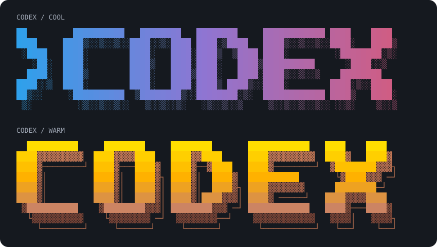

# Custom session headers

The `custom-ui` fork supports custom session headers through `[tui.header]` in
`$CODEX_HOME/config.toml` (normally `%USERPROFILE%\.codex\config.toml` on Windows).
Restart Codex after editing the configuration or template file.

## Customize the standard header

```toml
[tui.header]
title = "Maksim Codex"
icon = "λ"
show_version = true
show_directory = true
```

Omitted settings preserve the standard header. Set `icon = ""` to hide the icon.
`show_version` and `show_directory` control the standard layout; a custom template
controls its own layout by including or omitting the corresponding placeholders.

## Replace the header with text or ASCII art

Use a TOML literal multiline string to preserve backslashes and spaces:

```toml
[tui.header]
title = "Maksim Codex"
text = '''
  /\
 /__\  {title} · v{version}
       {directory}
'''
```

Alternatively, save the template as a UTF-8 file and select it:

```toml
[tui.header]
file = "headers/custom.txt"
```

Relative paths resolve against `CODEX_HOME`, so this example reads
`%USERPROFILE%\.codex\headers\custom.txt`. Absolute paths are also supported;
use single quotes for Windows paths, e.g. `file = 'C:\Users\Maksim\header.txt'`.

| Placeholder | Value |
| --- | --- |
| `{title}` | Configured title, or `OpenAI Codex` |
| `{icon}` | Configured icon, or `>_` |
| `{version}` | CLI version without the `v` prefix |
| `{directory}` | Current directory, with the home directory abbreviated as `~` |
| `{model}` | Model display name |
| `{effort}` | Reasoning effort, or an empty string |

Unknown placeholders stay literal. Values inserted into the template are not
expanded again. Templates support ANSI foreground colors and text styles,
including 24-bit RGB gradients. Background fills and reverse video are removed
so the terminal background remains visible. Other terminal commands are ignored,
and raw text/copy output contains no ANSI sequences.
Each line receives the normal two-column header indentation and is clipped to
the available terminal width, preserving ASCII-art spacing rather than wrapping.

Files are loaded when a header is created, not on every redraw. The file takes
precedence over inline `text`. Unreadable files, invalid UTF-8, and files larger
than 64 KiB log a warning and fall back to `text`, or to the standard header if
no inline template is set. An empty template hides the visual header content.
The permissions notice for YOLO mode remains visible with every layout.

The custom header is used during session loading, in the active session, and
after clearing the screen. The `/status` card keeps its standard title.

## Pixel-art CODEX examples



Two ready-to-use Unicode block-art templates are included:

- [codex-cool.ansi](header-examples/codex-cool.ansi): cyan, violet, and pink with a dithered shadow.
- [codex-warm.ansi](header-examples/codex-warm.ansi): yellow, amber, and copper with an offset outline.

Copy either file into `$CODEX_HOME/headers`, then select it:

```toml
[tui.header]
file = "headers/codex-cool.ansi"
```

Alternatively, point `file` directly at the example in your checkout using an
absolute path. Both presets fit an 80-column terminal, including the header's
indentation, and include a `{directory}` line below the artwork. Matching `.txt`
files provide the same lettering without color codes.

Regenerate the examples and vector preview from the repository root with:

```sh
node scripts/generate-header-examples.mjs
```

## Convert an image into ANSI art

On Windows, the PowerShell converter uses System.Drawing and requires no extra
packages. It accounts for terminal cell proportions and emits foreground-only
24-bit RGB blocks, compatible with the header renderer:

```powershell
pwsh -NoProfile -File scripts/convert-image-to-ansi.ps1 `
  -InputPath 'C:\path\picture.jpg' `
  -OutputPath docs/header-examples/picture.ansi `
  -Columns 76 `
  -PreviewPath out/picture-preview.png
```

The output must fit the 64 KiB header limit. For a square image, 76 columns
produce 38 terminal rows; use `-Columns 48` for a compact 48-by-24 version.
The converter leaves the original image unchanged.

Ready-made portrait examples:

- [pink-portrait.ansi](header-examples/pink-portrait.ansi): 76 columns by 38 rows.
- [pink-portrait-compact.ansi](header-examples/pink-portrait-compact.ansi): 48 columns by 24 rows.
- [Preview](header-examples/pink-portrait-preview.png).
